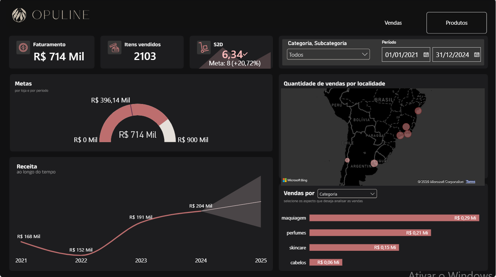

# OPULINE | Análise de Vendas com Power BI

## Sobre o projeto

Este projeto foi desenvolvido durante um curso da **Alura**, acompanhando as aulas práticas e aplicando os conhecimentos apresentados pelo instrutor.

O objetivo foi desenvolver habilidades em análise de dados, utilizando o Power BI para realizar o tratamento, a modelagem e a visualização de informações comerciais.

Durante o curso, pratiquei a construção de dashboards interativos, criação de indicadores, utilização de medidas DAX e organização dos dados para análise.

## Ferramentas e tecnologias utilizadas

- **Power BI Desktop:** criação dos dashboards e relatórios interativos.
- **Power Query:** preparação e transformação dos dados.
- **DAX (Data Analysis Expressions):** criação de medidas e indicadores.
- **Modelagem de Dados:** organização das tabelas e seus relacionamentos.
- **Visualização de Dados:** construção de gráficos, indicadores e filtros interativos.

## Dashboard de Vendas



O dashboard apresenta uma visão geral do desempenho comercial, incluindo:

- Faturamento total de aproximadamente R$ 714 mil.
- 2.103 itens vendidos.
- Acompanhamento de metas.
- Evolução da receita entre 2021 e 2024.
- Distribuição geográfica das vendas.
- Análise do faturamento por categoria.

## Dashboard de Produtos


O dashboard permite explorar o desempenho dos produtos comercializados, utilizando:

- Ranking dos produtos vendidos.
- Gráfico de dispersão para comparação de indicadores.
- Filtros por origem, categoria e subcategoria.
- Seleção de períodos para análise.

## Modelagem de Dados


Durante o desenvolvimento, pratiquei a organização e o relacionamento entre tabelas, incluindo informações de produtos, pedidos, categorias, marcas, calendário e metas.

A modelagem permite integrar diferentes informações para construir análises no Power BI.

## Medidas DAX Utilizadas

Durante o desenvolvimento do projeto OPULINE, realizado como atividade prática de um curso da Alura, utilizei a linguagem DAX (*Data Analysis Expressions*) para criar medidas e indicadores que auxiliam na análise do desempenho das vendas.

### 1. Faturamento

```dax
Faturamento =
SUMX(
    fPedidos,
    fPedidos[quantidade] * RELATED(dProdutosFinais[Preço])
)
```

**Objetivo:** calcular o faturamento total, multiplicando a quantidade de cada pedido pelo preço do produto correspondente.

**Funções utilizadas:**
- `SUMX`: percorre os registros da tabela de pedidos e soma os resultados das multiplicações.
- `RELATED`: busca o preço correspondente na tabela de produtos relacionada.

### 2. Faturamento Médio

```dax
FaturamentoMédio =
AVERAGEX(
    fPedidos,
    fPedidos[quantidade] * RELATED(dProdutosFinais[Preço])
)
```

**Objetivo:** calcular o valor médio das linhas de pedidos, considerando a quantidade multiplicada pelo preço do produto.

**Funções utilizadas:**
- `AVERAGEX`: calcula a média dos resultados de uma expressão avaliada para cada registro.
- `RELATED`: recupera o preço do produto na tabela relacionada.

### 3. Meta Máxima

```dax
MetáMaxima =
IF(
    [Faturamento] < [SomaMetas],
    [SomaMetas] * 1.2,
    [Faturamento]
)
```

**Objetivo:** definir um valor de referência para a escala de visualização de metas. Quando o faturamento está abaixo da meta, utiliza 120% da meta; caso contrário, utiliza o próprio faturamento.

**Função utilizada:**
- `IF`: avalia uma condição e retorna resultados diferentes conforme ela seja verdadeira ou falsa.

### 4. Meta S2Door

```dax
MetaS2Door = 8
```

**Objetivo:** estabelecer um valor fixo de referência igual a 8, utilizado como meta em um indicador do relatório.

### 5. Quantidade

```dax
Quantidade =
SUM(fPedidos[quantidade])
```

**Objetivo:** calcular a quantidade total de itens registrados nos pedidos.

**Função utilizada:**
- `SUM`: soma os valores de uma coluna numérica.

### 6. Soma das Metas

```dax
SomaMetas =
AVERAGE(dMetaMensal[Meta])
```

**Objetivo:** calcular a média dos valores registrados na coluna de metas mensais.

**Função utilizada:**
- `AVERAGE`: calcula a média aritmética dos valores numéricos de uma coluna.

### Conhecimentos praticados

Com essas medidas, pratiquei:

- Criação de medidas utilizando DAX.
- Utilização de funções de agregação, como `SUM` e `AVERAGE`.
- Cálculos iterativos com `SUMX` e `AVERAGEX`.
- Recuperação de informações entre tabelas relacionadas com `RELATED`.
- Aplicação de condições lógicas com `IF`.
- Construção de indicadores de faturamento, quantidade e metas.

## Tratamento de Dados com Power Query

Durante o desenvolvimento do projeto OPULINE, como parte das atividades práticas do curso da Alura, utilizei o Power Query para praticar a preparação e a transformação dos dados antes da construção dos dashboards.

Entre as operações realizadas durante as aulas, destacam-se:

- **Importação de dados:** conexão com a fonte de dados utilizada no projeto.
- **Promoção de cabeçalhos:** organização dos nomes das colunas para facilitar a identificação das informações.
- **Alteração de tipos de dados:** adequação dos campos aos formatos necessários para análise.
- **Remoção de colunas:** exclusão de informações que não seriam utilizadas nas análises.
- **Remoção de duplicatas:** tratamento de registros repetidos nas consultas correspondentes.

As consultas foram organizadas em tabelas relacionadas a produtos, pedidos, marcas, categorias e metas.

Essas atividades permitiram praticar conceitos de preparação e estruturação de dados, fundamentais para o desenvolvimento de relatórios no Power BI.

### Observação sobre a fonte de dados

Este projeto foi desenvolvido durante um curso da Alura, utilizando uma base de dados disponibilizada para as atividades práticas.

Os dados previamente importados, as medidas DAX, os relacionamentos e os dashboards permanecem disponíveis no arquivo Power BI.

Entretanto, a fonte Excel original não está mais disponível. Dessa forma, a atualização dos dados e a execução de determinadas etapas do Power Query dependem da recuperação ou reconexão à fonte original.

## Insights e Análise dos Resultados

A partir da exploração dos dashboards desenvolvidos durante o curso da Alura, realizei uma análise dos principais indicadores comerciais, buscando identificar tendências, diferenças de desempenho e oportunidades de investigação.

### 1. Evolução anual do faturamento

A análise demonstrou uma redução de **9,52% no faturamento de 2022 em relação a 2021**, seguida de uma recuperação de **20,41% em 2023**.

Considerando essas variações, o faturamento de 2023 superou o de 2021 em aproximadamente **8,95%**, indicando uma recuperação superior à queda registrada anteriormente.

Em 2024, o faturamento alcançou aproximadamente **R$ 204 mil**, mantendo a trajetória de crescimento observada desde 2023.

**Interpretação:** após a queda em 2022, os resultados apresentaram recuperação e crescimento nos dois anos seguintes. Seria interessante investigar quais produtos e categorias contribuíram para essa evolução.

### 2. Participação das categorias no faturamento

A análise por categoria apresentou os seguintes valores aproximados:

| Categoria | Faturamento |
|---|---:|
| Maquiagem | R$ 290 mil |
| Perfumes | R$ 210 mil |
| Skincare | R$ 150 mil |
| Cabelos | R$ 60 mil |

A categoria **Maquiagem apresentou o maior faturamento**, seguida por Perfumes.

Juntas, essas duas categorias representam aproximadamente **70% do faturamento total**, considerando os valores arredondados exibidos no dashboard.

**Interpretação:** existe uma concentração relevante do faturamento nas categorias Maquiagem e Perfumes. Isso pode indicar a importância comercial desses segmentos e justificar análises mais detalhadas sobre sua evolução, quantidade vendida e participação na receita.

### 3. Desempenho das metas

O dashboard apresenta um faturamento acumulado de aproximadamente **R$ 714 mil**, enquanto o indicador de metas exibe uma referência de aproximadamente **R$ 396,14 mil**.

O faturamento está acima desse valor de referência. Entretanto, antes de concluir que houve superação da meta comercial acumulada, é necessário verificar como a medida foi calculada.

**Interpretação:** o acompanhamento de metas é importante para avaliar o desempenho comercial, mas os indicadores precisam utilizar períodos e critérios de agregação compatíveis para permitir comparações adequadas.

### 4. Distribuição geográfica das vendas

O mapa apresenta registros de vendas em diferentes localidades, com pontos distribuídos por diversas regiões.

**Interpretação:** a distribuição geográfica permite identificar áreas com maior concentração de vendas e investigar diferenças de desempenho regional.

Uma análise complementar poderia comparar faturamento, quantidade vendida e participação percentual por cidade, identificando localidades com maior relevância comercial.

### 5. Desempenho individual dos produtos

O dashboard de Produtos apresenta um ranking com diferenças significativas entre os valores dos produtos analisados.

O gráfico de barras permite identificar produtos de maior destaque, enquanto o gráfico de dispersão possibilita comparar indicadores e observar a distribuição dos resultados.

**Interpretação:** os produtos não apresentam desempenho uniforme. A concentração de resultados em determinados itens pode orientar investigações sobre participação no faturamento, volume de vendas e oportunidades de crescimento.

### 6. Relação entre preço e faturamento

O gráfico de dispersão apresenta produtos distribuídos de acordo com indicadores de preço e faturamento.

Observa-se que produtos com diferentes valores de preço também apresentam diferentes níveis de faturamento, incluindo alguns pontos que se destacam dos demais.

**Interpretação:** o preço, isoladamente, não é suficiente para explicar o desempenho comercial de um produto. É importante considerar também a quantidade vendida, a categoria e outros fatores que possam influenciar a receita.

### 7. Principais conclusões

A análise dos dashboards permitiu identificar:

- Recuperação do faturamento após a queda registrada em 2022.
- Crescimento do faturamento em 2023 e 2024.
- Maior concentração de receita nas categorias Maquiagem e Perfumes.
- Diferenças relevantes de desempenho entre os produtos.
- Possibilidades de aprofundamento das análises por categoria, período e localização.

A atividade contribuiu para o desenvolvimento da minha capacidade de interpretar indicadores, identificar tendências e formular perguntas analíticas a partir dos dados apresentados.

Como continuidade dos estudos, pretendo aprofundar as análises para compreender melhor os fatores relacionados às variações de faturamento e ao desempenho dos produtos.

## Processo de aprendizado

Além dos dashboards principais, o arquivo contém páginas auxiliares utilizadas durante as aulas para praticar diferentes tipos de gráficos, parâmetros e funcionalidades do Power BI.

Essas páginas foram mantidas no arquivo original como registro do aprendizado, mas ocultadas da apresentação principal para proporcionar uma navegação mais organizada.

## Origem do projeto

Projeto educacional desenvolvido acompanhando as aulas da plataforma **Alura**, como parte dos meus estudos e desenvolvimento de habilidades em Power BI e Análise de Dados.
