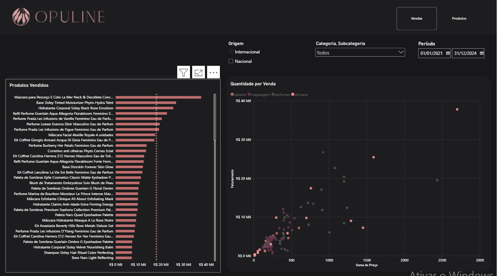
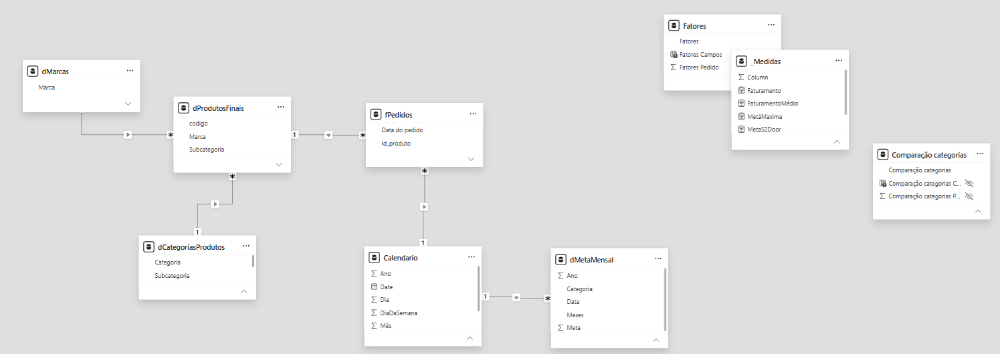

# OPULINE | Análise de Vendas com Power BI

## Sobre o projeto
Projeto de análise de vendas desenvolvido no Power BI, com foco no acompanhamento do faturamento, desempenho dos produtos, metas e distribuição geográfica das vendas.

## Ferramentas e tecnologias
- Power BI Desktop
- Power Query
- DAX
- Modelagem de dados
- Visualização de dados

## Dashboard de Vendas

O painel apresenta faturamento de aproximadamente R$ 714 mil, 2.103 itens vendidos, indicadores de metas, evolução da receita e análise geográfica.

## Dashboard de Produtos

O painel permite analisar produtos vendidos e comparar indicadores por meio de gráficos de barras e dispersão.

## Modelagem de Dados

O modelo apresenta tabelas de produtos, pedidos, calendário, marcas, categorias e metas, com relacionamentos para apoiar as análises.

## DAX
As medidas DAX utilizadas no projeto serão documentadas nesta seção, com seus cálculos e objetivos.

## Power Query
As etapas de preparação e transformação dos dados serão documentadas nesta seção.

## Autoria
Projeto desenvolvido para fins de estudo e portfólio em Análise de Dados.
